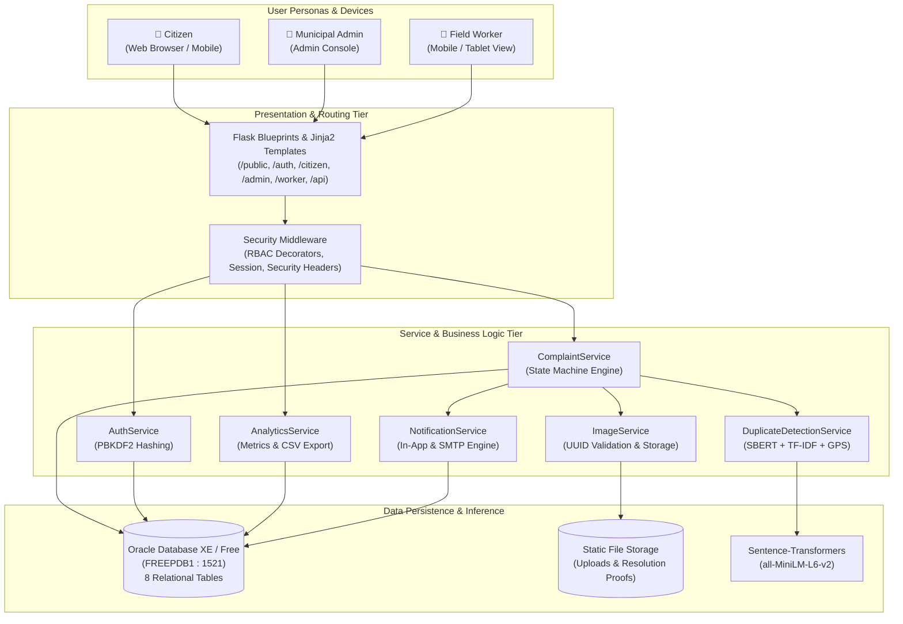
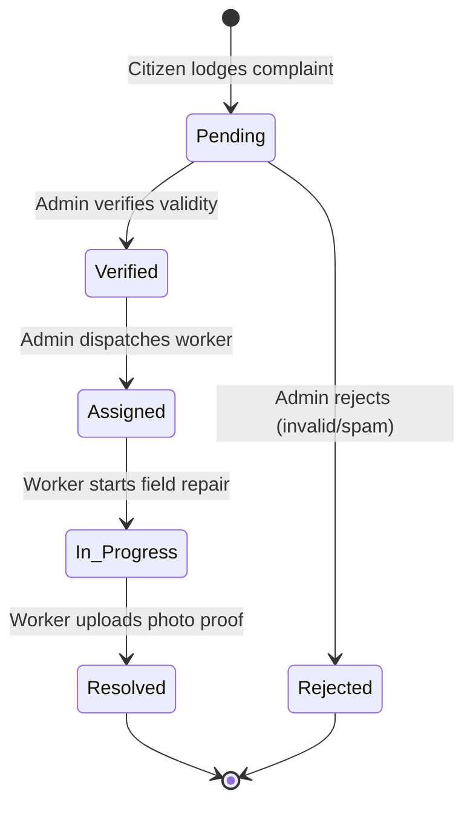

# 🚀 CivicPulse — Smart Citizen Grievance Management System

> **A Complete Full-Stack Civic Complaint Management Platform** built with **Python 3, Flask, Oracle Database (FREEPDB1), Machine Learning (Sentence Transformers / TF-IDF), HTML5, CSS3, JavaScript, Leaflet Maps, and Chart.js**.

---

## 📌 Project Overview

**CivicPulse** is an enterprise-grade digital civic governance solution designed for municipal corporations to streamline citizen grievance registration, automated duplicate issue detection, administrative verification, field worker dispatch, photographic resolution proof tracking, and real-time municipal performance analytics.

Developed as an **MCA Placement & Final Project** by **Sagar Sen Sethi** at the **National Institute of Technology Warangal**.

---

## 🏗️ System Architecture & Data Flow

> 📖 **Full Architectural Specification:** For deep technical details, UML sequence flows, and ML pipeline mathematics, see [**docs/system_architecture.md**](docs/system_architecture.md).  
> 🗄️ **Relational Schema Specification:** For the complete 8-table Oracle schema, column types, and constraints, see [**docs/database_design.md**](docs/database_design.md).

### 🏛️ High-Level System Architecture Diagram



### 🔄 Grievance State Machine Lifecycle



### 📦 Multi-Tier Structural Model

```text
                                  ┌────────────────────────┐
                                  │   CITIZEN / USER UI    │
                                  │  Web Browser (Desktop) │
                                  └───────────┬────────────┘
                                              │
                         ┌────────────────────┼────────────────────┐
                         ▼                    ▼                    ▼
                ┌────────────────┐   ┌────────────────┐   ┌────────────────┐
                │ Citizen Portal │   │  Admin Portal  │   │ Worker Portal  │
                │ (/citizen/*)   │   │  (/admin/*)    │   │ (/worker/*)    │
                └────────┬───────┘   └────────┬───────┘   └────────┬───────┘
                         │                    │                    │
                         └────────────────────┼────────────────────┘
                                              ▼
                                 ┌─────────────────────────┐
                                 │   ROUTING & MIDDLEWARE  │
                                 │ Flask Blueprints & RBAC │
                                 │ Security Headers (Day26)│
                                 └────────────┬────────────┘
                                              ▼
        ┌───────────────────────────────────────────────────────────────────────────┐
        │                              SERVICE LAYER                                │
        ├──────────────────────┬──────────────────────┬─────────────────────────────┤
        │  AuthService         │  ComplaintService    │  DuplicateDetectionService  │
        │  ValidationService   │  ImageService        │  (SBERT + TF-IDF + GPS)     │
        │  NotificationService │  AnalyticsService    │                             │
        └──────────────────────┴──────────────┬───────┴─────────────────────────────┘
                                              ▼
        ┌───────────────────────────────────────────────────────────────────────────┐
        │                              MODEL LAYER                                  │
        ├──────────────────────┬──────────────────────┬─────────────────────────────┤
        │  UserModel           │  ComplaintModel      │  ComplaintImageModel        │
        │  StatusHistoryModel  │  Upvote / Feedback   │  Category Queries           │
        └──────────────────────┴──────────────┬───────┴─────────────────────────────┘
                                              ▼
        ┌───────────────────────────────────────────────────────────────────────────┐
        │                       ORACLE DATABASE (FREEPDB1)                          │
        ├──────────────────────┬──────────────────────┬─────────────────────────────┤
        │  USERS               │  COMPLAINTS          │  ISSUE_CATEGORIES           │
        │  STATUS_HISTORY      │  COMPLAINT_IMAGES    │  NOTIFICATIONS              │
        │  COMPLAINT_UPVOTES   │  COMPLAINT_FEEDBACK  │                             │
        └──────────────────────┴──────────────────────┴─────────────────────────────┘
```

---

## ✨ Features Implemented by Day (Days 1–30)

### 🔹 Phase 1: Core Foundation & Citizen System (Days 1–12)
- **Day 1–3**: Flask application factory, environment configuration, database connection pooling with Oracle DB `FREEPDB1`.
- **Day 4–7**: User authentication, PBKDF2/SHA-256 password hashing, session management, and Role-Based Access Control (`Citizen`, `Admin`, `Worker`).
- **Day 8–10**: Citizen Dashboard, Report Issue form with multi-category mapping (Pothole `#6`, Garbage `#7`, Street Light `#8`, Water Leakage `#9`, Drainage `#10`), severity ratings, and secure image upload with MIME-type checks and UUID filenames.
- **Day 11–12**: "My Complaints" list with real-time text search and status filter, Complaint Details view, and chronological status history timeline.

### 🔹 Phase 2: Administrative Control & Field Worker Dispatch (Days 13–17)
- **Day 13 — Admin Dashboard**: Real-time KPI summary cards (Total, Pending, Verified, Assigned, In Progress, Resolved, Rejected), Chart.js status doughnut and category bar charts.
- **Day 14 — Admin Complaint Management**: Searchable complaint table with multi-factor filters (Status, Category, Priority, Search Query), verification flow, and structured rejection with citizen notification.
- **Day 15 — Complaint Assignment & Workers Directory**: Worker roster monitoring active task loads, dispatch mechanism with atomic status transitions (`Pending` $\rightarrow$ `Verified` $\rightarrow$ `Assigned`).
- **Day 16 — Field Worker Dashboard**: Worker authentication, task board sorted by priority (High, Medium, Low), task detail inspection with citizen contact info and location.
- **Day 17 — Worker Status Progression**: Validated state machine (`Assigned` $\rightarrow$ `In Progress` $\rightarrow$ `Resolved`), progress notes, and automated status history audit logging.

### 🔹 Phase 3: Advanced Intelligence & Civic Engagement (Days 18–25)
- **Day 18 — Resolution Proof Upload**: Photographic evidence upload upon job completion, stored securely under `static/uploads/resolution_proofs/`, displayed on the resolution certificate.
- **Day 19 — End-to-End Status Tracking**: Citizen transparency portal displaying assigned worker identity, completion photos, resolution timestamps, and full lifecycle timeline.
- **Day 20 — Email Notification Service**: Modular SMTP notification service for submission, assignment, and resolution events with graceful fallback when SMTP is not configured.
- **Day 21 — Duplicate Complaint Detection (NLP & Geospatial)**:
  - Hybrid text similarity engine (Sentence-Transformers SBERT `all-MiniLM-L6-v2` with TF-IDF cosine similarity fallback).
  - Haversine mathematical distance calculation detecting nearby issues within configurable **100m proximity**.
  - Interactive AJAX pre-submission alert warning citizens of existing complaints.
- **Day 22 — Citizen Upvotes & Resolution Feedback**:
  - Upvoting system with database constraint preventing duplicate votes (`COMPLAINT_UPVOTES`).
  - 5-Star quality rating and feedback reviews on resolved grievances (`COMPLAINT_FEEDBACK`).
- **Day 23 — Severity & Priority Calibration**: Priority rules (`Low`, `Medium`, `High`) with administrative priority override and audit logging.
- **Day 24 — Interactive Geospatial Map (Leaflet)**: Real-time map displaying all geo-tagged complaints with status-coded markers and popups using OpenStreetMap tiles (no paid API keys required).
- **Day 25 — Analytics & CSV Reporting**: Departmental performance reports, worker resolution rates, and one-click full dataset CSV export (`/admin/export-csv`).

### 🔹 Phase 4: Production Hardening, Testing & Verification (Days 26–30)
- **Day 26 — Security Hardening**:
  - HTTP Security Headers (`X-Content-Type-Options: nosniff`, `X-Frame-Options: SAMEORIGIN`, `X-XSS-Protection`).
  - Session cookie security (`HTTPOnly`, `SameSite=Lax`).
  - Path traversal and executable upload prevention.
  - Strict SQL parameterization across all queries.
- **Day 27 — End-to-End Integration Testing**: 16 comprehensive unit & integration tests using `pytest` covering authentication, RBAC, duplicate algorithms, validation, and exports.
- **Day 28 — Responsive UI & Error Handling**: Custom accessible 404 & 500 error pages, mobile-friendly navigation, and CSS animations.
- **Day 29 — Complete Documentation**: Comprehensive setup, database migrations, and operational guidelines.
- **Day 30 — Final Verification**: Verified end-to-end against live Oracle XE database.

---

## 🗄️ Database Architecture & Migrations

The database is built on **Oracle Database XE/Free (`localhost:1521/FREEPDB1`)**.

### Primary Tables
| Table | Description |
|---|---|
| `USERS` | Authentication, credentials, contact details, and role (`Citizen`, `Admin`, `Worker`). |
| `ISSUE_CATEGORIES` | Issue types (`Pothole`, `Garbage`, `Street Light`, `Water Leakage`, `Drainage`). |
| `COMPLAINTS` | Core grievance data, coordinates, status, priority, worker assignment, and resolution proof. |
| `STATUS_HISTORY` | Immutable audit trail of every status modification with actor and remarks. |
| `COMPLAINT_IMAGES` | Metadata for citizen photos and worker resolution proof images. |
| `NOTIFICATIONS` | In-app alerts for complaints and status updates. |
| `COMPLAINT_UPVOTES` | Unique citizen upvotes per complaint. |
| `COMPLAINT_FEEDBACK` | 1–5 star ratings and reviews for resolved complaints. |

### How to Run Migrations
All migrations are **additive, non-destructive**, and automated:

```powershell
# From project root:
python database/run_migrations.py
```

Or execute directly via SQL*Plus:
```sql
@database/schema.sql
@database/migrations/001_add_missing_tables.sql
@database/migrations/002_add_complaint_columns.sql
@database/migrations/003_add_upvotes_and_feedback.sql
```

---

## 🚀 Installation & Setup Guide (Windows / PowerShell)

### 1. Prerequisites
- **Python 3.10+** (tested on Python 3.13)
- **Oracle Database XE / Free** running on `localhost:1521/FREEPDB1`
- **PowerShell** / VS Code

### 2. Setup Virtual Environment & Install Dependencies
```powershell
# Open terminal in project root
cd c:\driveD_data\EndSem_MCA_Project\Placement_Project\civicpulse

# Optional: Create and activate virtual environment
python -m venv venv
.\venv\Scripts\Activate.ps1

# Install required packages
pip install -r requirements.txt
```

### 3. Configure Environment Variables
Copy `.env.example` to `.env`:
```powershell
Copy-Item .env.example .env
```
Ensure your Oracle credentials in `.env` match your local Oracle setup:
```ini
ORACLE_USER=system
ORACLE_PASSWORD=your_password
ORACLE_DSN=localhost:1521/FREEPDB1
```

### 4. Apply Database Migrations
```powershell
python database/run_migrations.py
```

### 5. Run the Integration Test Suite
```powershell
python -m pytest tests/test_civicpulse.py -v
```
*(All 16 test cases should pass with 100% success).*

### 6. Start the Web Server
```powershell
python app.py
```
Open your web browser and navigate to:
👉 **`http://127.0.0.1:5000`**

---

## 👥 Default Demo Credentials for Evaluation

| Role | Email | Password | Access / Purpose |
|---|---|---|---|
| **Administrator** | `admin@civicpulse.com` | `admin123` | Access `/admin/dashboard`, verify, reject, assign workers, view analytics, export CSV, view map. |
| **Field Worker 1** | `worker1@civicpulse.com` | `worker123` | Access `/worker/dashboard`, progress assigned tasks to `In Progress` and `Resolved`, upload proof photo. |
| **Field Worker 2** | `worker2@civicpulse.com` | `worker123` | Field Worker account for testing reassignments. |
| **Citizen** | `rahul@example.com` | `rahul123` | Access `/citizen/dashboard`, report issues, view status timeline, upvote, submit feedback. |

---

## 🧪 Testing Verification Summary

The complete automated test suite (`tests/test_civicpulse.py`) validates:
1. `test_app_initialization` — Verifies all blueprints and URL rules.
2. `test_security_headers` — Validates `X-Content-Type-Options`, `X-Frame-Options`, and `X-XSS-Protection`.
3. `test_public_pages` — Verifies HTTP 200 on Home, About, How it Works, and Categories.
4. `test_api_categories` — Checks category listing API response.
5. `test_unauthenticated_protected_routes` — Confirms unauthorized redirect to login.
6. `test_citizen_cannot_access_admin_dashboard` — Confirms role separation.
7. `test_worker_cannot_access_admin_dashboard` — Confirms worker cannot access admin panel.
8. `test_admin_authorized_access` — Verifies Admin access to dashboard, complaints, workers, map, and CSV export.
9. `test_worker_authorized_dashboard` — Verifies worker task board access.
10. `test_citizen_authorized_dashboard` — Verifies citizen dashboard and complaint tracking.
11. `test_registration_validation` — Tests password complexity, email regex, and phone validation.
12. `test_complaint_validation` — Tests form validation constraints.
13. `test_haversine_distance` — Tests 100m GPS proximity distance calculation.
14. `test_duplicate_text_similarity` — Tests text similarity scoring.
15. `test_notification_graceful_fallback` — Confirms system operates without crashing when SMTP is offline.
16. `test_file_utils` — Validates file extension whitelisting and UUID collision prevention.

---

## 👨‍💻 Author & Academic Submission

- **Student:** Sagar Sen Sethi
- **Program:** Master of Computer Applications (MCA)
- **Institution:** National Institute of Technology Warangal
- **GitHub:** [https://github.com/Sagarsen2001](https://github.com/Sagarsen2001)
- **License:** MIT License
