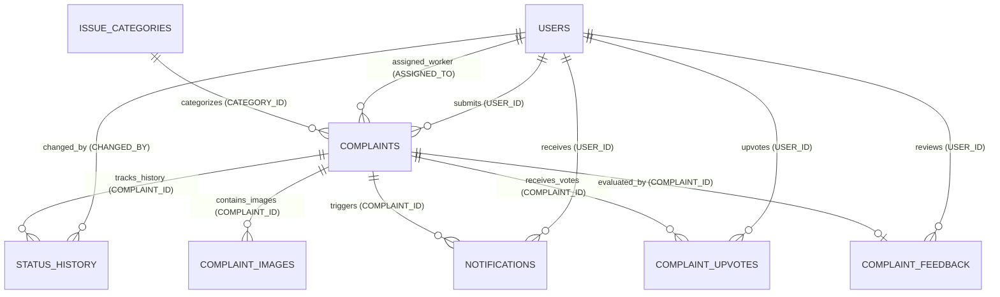

# 🗄️ CivicPulse — Relational Database Design Document

> **Database System:** Oracle Database XE / Free  
> **Pluggable Database (PDB) Service:** `FREEPDB1`  
> **Default Port:** `1521`  
> **Schema Name:** `C##CIVICPULSE` (or configured Oracle user)  
> **Driver:** `oracledb` (Thin & Thick modes supported)  

---

## 📌 1. Overview & Data Architecture

The CivicPulse persistence tier is built on an enterprise Oracle Database using normalized relational schemas, strict foreign key constraints, identity sequences, and performance indexes. 

The schema consists of **8 integrated tables**:

1. **`USERS`**: User identity, role authentication, contact data.
2. **`ISSUE_CATEGORIES`**: Departmental grievance categories (Pothole, Garbage, Drainage, Street Light, Water Leakage).
3. **`COMPLAINTS`**: Core grievance entities with geospatial coordinates, severity, priority, and assignment links.
4. **`STATUS_HISTORY`**: Immutable chronological audit trail of all grievance state transitions.
5. **`COMPLAINT_IMAGES`**: Photographic evidence links (both initial problem pictures and resolution proofs).
6. **`NOTIFICATIONS`**: In-app citizen and worker notification queue.
7. **`COMPLAINT_UPVOTES`**: Civic community voting records (enforcing one vote per user per complaint).
8. **`COMPLAINT_FEEDBACK`**: Post-resolution citizen satisfaction evaluations (1–5 star ratings and reviews).

---

## 📊 2. Entity-Relationship Diagram (ERD)



---

## 📋 3. Detailed Table Specifications

### 3.1 `USERS` Table
Stores all registered accounts across Citizen, Admin, and Worker roles.

| Column | Data Type | Nullable | Default | Description / Constraints |
|---|---|:---:|---|---|
| `USER_ID` | `NUMBER` | **NO** | `IDENTITY (PK)` | Unique surrogate identifier |
| `FULL_NAME` | `VARCHAR2(100)` | **NO** | — | User's full name |
| `EMAIL` | `VARCHAR2(100)` | **NO** | — | Unique login email (`UQ_USERS_EMAIL`) |
| `USER_PASSWORD` | `VARCHAR2(255)` | **NO** | — | PBKDF2/SHA-256 hashed password string |
| `PHONE_NUMBER` | `VARCHAR2(15)` | YES | NULL | Contact mobile number |
| `ROLE` | `VARCHAR2(20)` | **NO** | `'Citizen'` | `CHECK (ROLE IN ('Citizen', 'Admin', 'Worker'))` |
| `CREATED_AT` | `TIMESTAMP` | **NO** | `CURRENT_TIMESTAMP` | Account registration timestamp |

---

### 3.2 `ISSUE_CATEGORIES` Table
Stores grievance departments and classifications. Pre-seeded with standard municipal issues (IDs 6–10).

| Column | Data Type | Nullable | Default | Description / Constraints |
|---|---|:---:|---|---|
| `CATEGORY_ID` | `NUMBER` | **NO** | `IDENTITY (PK)` | Category identifier (IDs 6–10) |
| `CATEGORY_NAME` | `VARCHAR2(100)` | **NO** | — | Unique category title (`UQ_CATEGORY_NAME`) |
| `DESCRIPTION` | `VARCHAR2(300)` | YES | NULL | Scope & operational description |
| `CREATED_AT` | `TIMESTAMP` | **NO** | `CURRENT_TIMESTAMP` | Record creation timestamp |

**Default Seed Data:**
- ID 6: `Pothole` — Road damage, cracks, potholes, pavement erosion.
- ID 7: `Garbage` — Overflowing bins, uncollected waste, illegal dumping.
- ID 8: `Street Light` — Non-functional, flickering, or damaged street lights.
- ID 9: `Water Leakage` — Burst pipes, municipal water supply wastage, low pressure.
- ID 10: `Drainage` — Clogged stormwater drains, sewage overflow, stagnant runoff.

---

### 3.3 `COMPLAINTS` Table
Central entity containing grievance details, geospatial coordinates, assignment status, and timestamps.

| Column | Data Type | Nullable | Default | Description / Constraints |
|---|---|:---:|---|---|
| `COMPLAINT_ID` | `NUMBER` | **NO** | `IDENTITY (PK)` | Unique complaint tracking identifier |
| `USER_ID` | `NUMBER` | **NO** | — | `FK -> USERS(USER_ID)` (Reporting Citizen) |
| `CATEGORY_ID` | `NUMBER` | **NO** | — | `FK -> ISSUE_CATEGORIES(CATEGORY_ID)` |
| `TITLE` | `VARCHAR2(150)` | **NO** | — | Brief summary headline |
| `DESCRIPTION` | `VARCHAR2(1000)` | **NO** | — | Detailed problem narrative |
| `SEVERITY` | `VARCHAR2(20)` | **NO** | `'Low'` | `CHECK (SEVERITY IN ('Low', 'Medium', 'High', 'Critical'))` |
| `LOCATION` | `VARCHAR2(255)` | **NO** | — | Human-readable street address or landmark |
| `LATITUDE` | `NUMBER(10,7)` | YES | NULL | WGS84 GPS Latitude float |
| `LONGITUDE` | `NUMBER(10,7)` | YES | NULL | WGS84 GPS Longitude float |
| `IMAGE_PATH` | `VARCHAR2(500)` | YES | NULL | Relative path to initial uploaded problem photo |
| `STATUS` | `VARCHAR2(20)` | **NO** | `'Pending'` | `CHECK (STATUS IN ('Pending', 'Verified', 'Assigned', 'In Progress', 'Resolved', 'Rejected'))` |
| `PRIORITY` | `VARCHAR2(10)` | **NO** | `'Low'` | `CHECK (PRIORITY IN ('Low', 'Medium', 'High', 'Critical'))` |
| `CREATED_AT` | `TIMESTAMP` | **NO** | `CURRENT_TIMESTAMP` | Grievance lodging timestamp |
| `UPDATED_AT` | `TIMESTAMP` | YES | NULL | Last modification timestamp |
| `ASSIGNED_TO` | `NUMBER` | YES | NULL | `FK -> USERS(USER_ID)` (Field Worker) |
| `RESOLUTION_PROOF`| `VARCHAR2(500)` | YES | NULL | Relative path to post-completion photo |
| `RESOLVED_AT` | `TIMESTAMP` | YES | NULL | Timestamp of completion |

---

### 3.4 `STATUS_HISTORY` Table
Immutable chronological ledger recording all state changes for accountability.

| Column | Data Type | Nullable | Default | Description / Constraints |
|---|---|:---:|---|---|
| `HISTORY_ID` | `NUMBER` | **NO** | `IDENTITY (PK)` | Unique history record ID |
| `COMPLAINT_ID` | `NUMBER` | **NO** | — | `FK -> COMPLAINTS(COMPLAINT_ID)` |
| `OLD_STATUS` | `VARCHAR2(20)` | YES | NULL | Prior status before modification |
| `NEW_STATUS` | `VARCHAR2(20)` | **NO** | — | Updated status |
| `CHANGED_BY` | `NUMBER` | YES | NULL | `FK -> USERS(USER_ID)` (Actor responsible) |
| `CHANGED_AT` | `TIMESTAMP` | **NO** | `CURRENT_TIMESTAMP` | Transition timestamp |
| `REMARKS` | `VARCHAR2(1000)` | YES | NULL | Administrative or worker justification |

---

### 3.5 `COMPLAINT_IMAGES` Table
Stores multi-image references attached to grievances.

| Column | Data Type | Nullable | Default | Description / Constraints |
|---|---|:---:|---|---|
| `IMAGE_ID` | `NUMBER` | **NO** | `IDENTITY (PK)` | Unique image record ID |
| `COMPLAINT_ID` | `NUMBER` | **NO** | — | `FK -> COMPLAINTS(COMPLAINT_ID)` |
| `IMAGE_PATH` | `VARCHAR2(500)` | **NO** | — | Relative filesystem path under `static/uploads/` |
| `IMAGE_TYPE` | `VARCHAR2(20)` | **NO** | `'COMPLAINT'`| `CHECK (IMAGE_TYPE IN ('COMPLAINT', 'RESOLUTION'))` |
| `UPLOADED_AT` | `TIMESTAMP` | **NO** | `CURRENT_TIMESTAMP` | Image upload timestamp |

---

### 3.6 `NOTIFICATIONS` Table
Manages user notification messages and read/unread statuses.

| Column | Data Type | Nullable | Default | Description / Constraints |
|---|---|:---:|---|---|
| `NOTIFICATION_ID` | `NUMBER` | **NO** | `IDENTITY (PK)` | Unique notification ID |
| `USER_ID` | `NUMBER` | **NO** | — | `FK -> USERS(USER_ID)` (Recipient) |
| `COMPLAINT_ID` | `NUMBER` | YES | NULL | `FK -> COMPLAINTS(COMPLAINT_ID)` |
| `MESSAGE` | `VARCHAR2(500)` | **NO** | — | Notification message text |
| `IS_READ` | `NUMBER(1)` | **NO** | `0` | `0 = Unread, 1 = Read` |
| `CREATED_AT` | `TIMESTAMP` | **NO** | `CURRENT_TIMESTAMP` | Notification creation timestamp |

---

### 3.7 `COMPLAINT_UPVOTES` Table
Stores community support upvotes for grievances.

| Column | Data Type | Nullable | Default | Description / Constraints |
|---|---|:---:|---|---|
| `UPVOTE_ID` | `NUMBER` | **NO** | `IDENTITY (PK)` | Unique upvote record ID |
| `COMPLAINT_ID` | `NUMBER` | **NO** | — | `FK -> COMPLAINTS(COMPLAINT_ID)` |
| `USER_ID` | `NUMBER` | **NO** | — | `FK -> USERS(USER_ID)` |
| `CREATED_AT` | `TIMESTAMP` | **NO** | `CURRENT_TIMESTAMP` | Upvote timestamp |

> **Constraint:** `CONSTRAINT UQ_UPVOTE_USER_COMPLAINT UNIQUE (COMPLAINT_ID, USER_ID)` prevents duplicate voting.

---

### 3.8 `COMPLAINT_FEEDBACK` Table
Stores citizen satisfaction ratings and quality reviews upon grievance resolution.

| Column | Data Type | Nullable | Default | Description / Constraints |
|---|---|:---:|---|---|
| `FEEDBACK_ID` | `NUMBER` | **NO** | `IDENTITY (PK)` | Unique feedback record ID |
| `COMPLAINT_ID` | `NUMBER` | **NO** | — | `FK -> COMPLAINTS(COMPLAINT_ID)` (`UNIQUE`) |
| `USER_ID` | `NUMBER` | **NO** | — | `FK -> USERS(USER_ID)` |
| `RATING` | `NUMBER(1)` | **NO** | — | `CHECK (RATING BETWEEN 1 AND 5)` |
| `COMMENTS` | `VARCHAR2(1000)` | YES | NULL | Review notes or compliments |
| `CREATED_AT` | `TIMESTAMP` | **NO** | `CURRENT_TIMESTAMP` | Review submission timestamp |

> **Constraint:** `CONSTRAINT UQ_FEEDBACK_COMPLAINT UNIQUE (COMPLAINT_ID)` restricts feedback to one submission per resolved issue.

---

## ⚡ 4. Database Indexes for Query Optimization

To ensure sub-second response times on dashboards and analytical queries, the following indexes are maintained:

```sql
-- Complaint Foreign Key & Filter Indexes
CREATE INDEX IDX_COMPLAINTS_USER ON COMPLAINTS(USER_ID);
CREATE INDEX IDX_COMPLAINTS_CATEGORY ON COMPLAINTS(CATEGORY_ID);
CREATE INDEX IDX_COMPLAINTS_STATUS ON COMPLAINTS(STATUS);
CREATE INDEX IDX_COMPLAINTS_ASSIGNED ON COMPLAINTS(ASSIGNED_TO);

-- Image & History Indexes
CREATE INDEX IDX_COMPLAINT_IMAGES_COMPLAINT ON COMPLAINT_IMAGES(COMPLAINT_ID);
CREATE INDEX IDX_STATUS_HISTORY_COMPLAINT ON STATUS_HISTORY(COMPLAINT_ID);

-- Notification & Community Indexes
CREATE INDEX IDX_NOTIFICATIONS_USER ON NOTIFICATIONS(USER_ID);
CREATE INDEX IDX_UPVOTES_COMPLAINT ON COMPLAINT_UPVOTES(COMPLAINT_ID);
CREATE INDEX IDX_UPVOTES_USER ON COMPLAINT_UPVOTES(USER_ID);
CREATE INDEX IDX_FEEDBACK_COMPLAINT ON COMPLAINT_FEEDBACK(COMPLAINT_ID);
```

---

## 🔒 5. Data Integrity & Transaction Management

- **Atomicity:** All status updates, worker reassignments, and audit logging happen within single transactional boundaries (`connection.commit()` or `connection.rollback()`).
- **Parameterized Queries:** All SQL statements use named binds (e.g. `:user_id`, `:complaint_id`), guaranteeing 100% protection against SQL Injection.
- **Referential Cascade Safety:** Restricts deletion of parent entities (`USERS`, `ISSUE_CATEGORIES`) while dependent complaints or history logs exist.