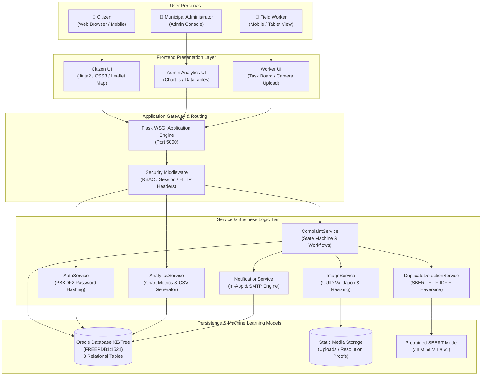
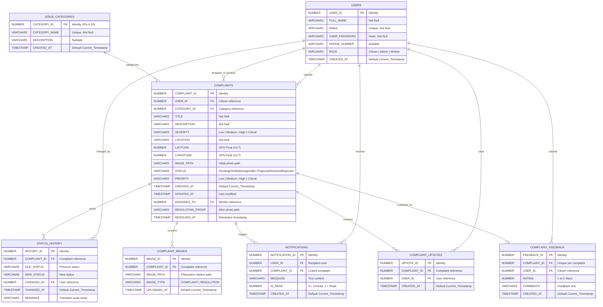
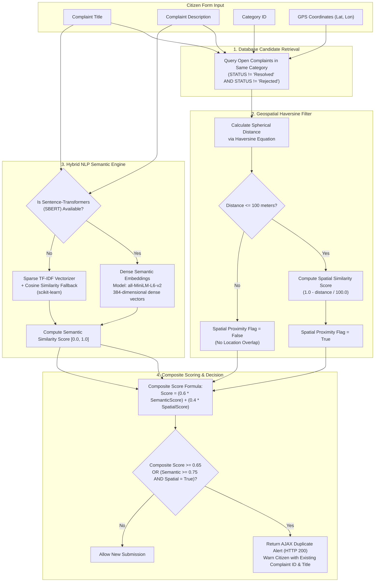
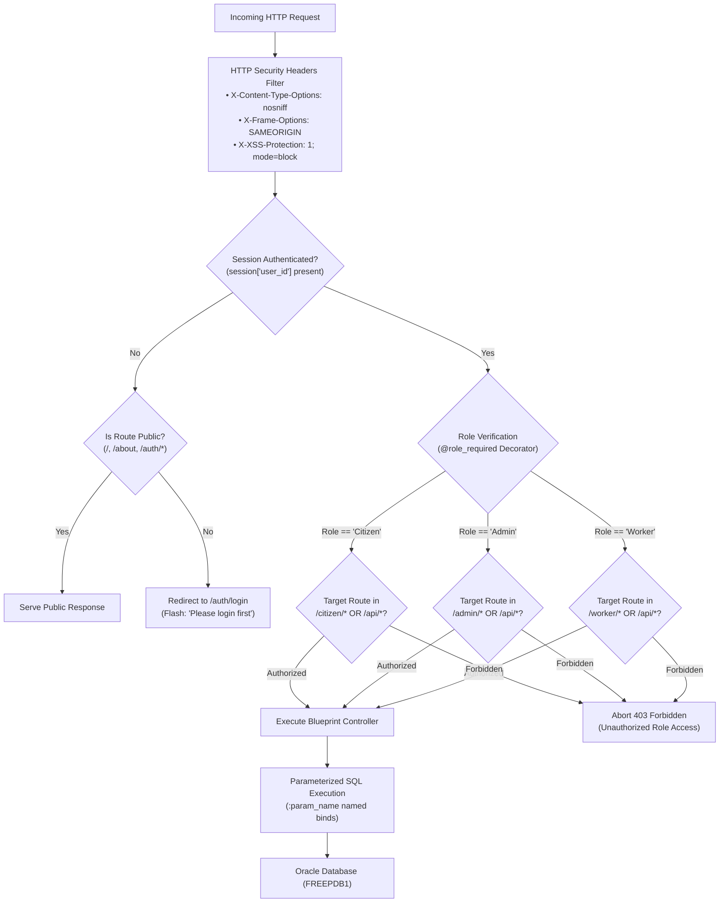
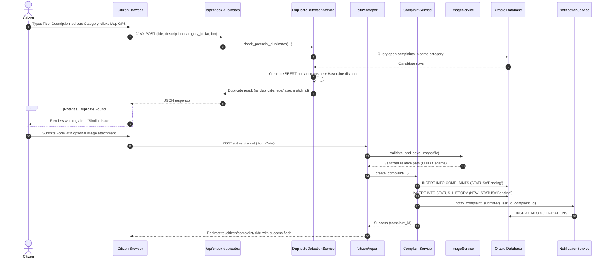
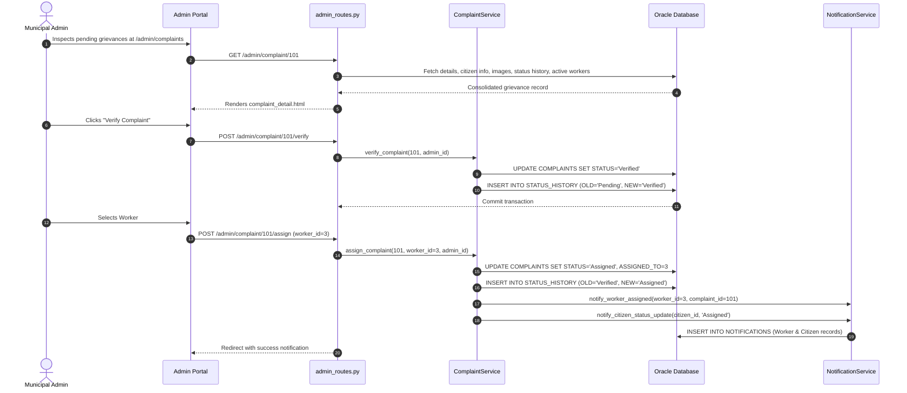
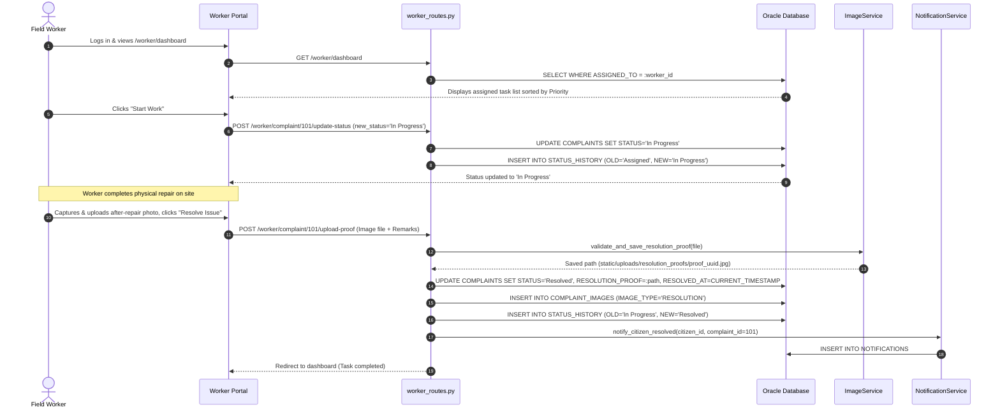
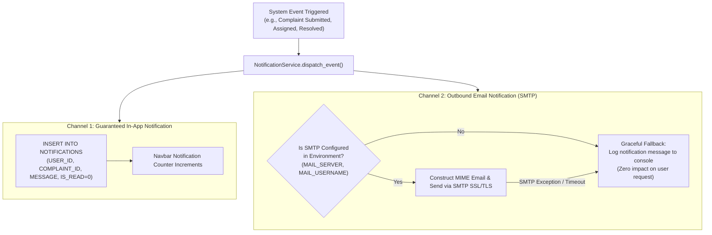
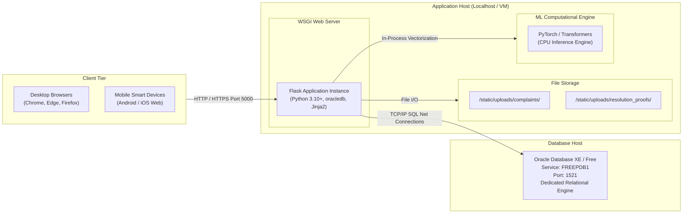

# 🏛️ CivicPulse — Comprehensive System Architecture Document

> **Project:** CivicPulse — Smart Citizen Grievance Management System  
> **Course / Degree:** Master of Computer Applications (MCA) — Final / Placement Project  
> **Institution:** National Institute of Technology Warangal  
> **Author:** Sagar Sen Sethi  
> **Architecture Pattern:** Multi-Tier Layered Architecture with Service-Repository Separation and Hybrid AI/ML Geospatial Pipeline  
> **Primary Technologies:** Python 3, Flask, Oracle Database XE/Free (`FREEPDB1`), Sentence-Transformers (SBERT), scikit-learn, Leaflet.js, Chart.js  

---

## 📑 Table of Contents
1. [Executive Summary & Architectural Paradigm](#1-executive-summary--architectural-paradigm)
2. [High-Level System Context Architecture](#2-high-level-system-context-architecture)
3. [Layered Software Architecture (Multi-Tier)](#3-layered-software-architecture-multi-tier)
4. [Component & Package Structure Mapping](#4-component--package-structure-mapping)
5. [Database Entity-Relationship (ER) Architecture](#5-database-entity-relationship-er-architecture)
6. [Complaint Lifecycle & Finite State Machine (FSM)](#6-complaint-lifecycle--finite-state-machine-fsm)
7. [AI/ML Duplicate Detection & Geospatial Pipeline](#7-aiml-duplicate-detection--geospatial-pipeline)
8. [Role-Based Access Control (RBAC) & Security Architecture](#8-role-based-access-control-rbac--security-architecture)
9. [Component Interaction & Sequence Diagrams](#9-component-interaction--sequence-diagrams)
   - 9.1 Citizen Complaint Registration & Real-time AI Duplicate Detection
   - 9.2 Administrative Verification & Field Worker Dispatch
   - 9.3 Field Worker Task Execution & Photographic Resolution
10. [Notification & Event Dispatch Architecture](#10-notification--event-dispatch-architecture)
11. [Deployment Topology & Hardware Environment](#11-deployment-topology--hardware-environment)

---

## 1. Executive Summary & Architectural Paradigm

**CivicPulse** is an enterprise-scale, citizen-centric grievance redressal platform engineered for municipal administrative bodies. The architecture follows modern software engineering principles:

- **Layered Decoupling:** Strict separation between the Presentation Layer (Jinja2, responsive CSS, client-side JS), Routing & Middleware Layer (Flask Blueprints with RBAC decorators), Service/Business Logic Layer, Data Access Models, and the Oracle Relational Database.
- **Service-Repository Design Pattern:** Route handlers delegate business rules, computational scoring, and transactional operations to specialized Service classes (`ComplaintService`, `DuplicateDetectionService`, `AnalyticsService`, `NotificationService`).
- **Hybrid AI/ML & Geospatial Engine:** Natural Language Processing (SBERT embeddings with TF-IDF fallback) coupled with spherical Haversine distance computations to detect duplicate complaints within a 100-meter radius in real-time.
- **ACID Transactional Integrity:** Leverages Oracle Database Free (`FREEPDB1`) for atomic status transitions, comprehensive foreign-key constraints, check constraints, and immutable audit logging in `STATUS_HISTORY`.
- **Defensive Production Security:** Enforces parameterized queries across 100% of SQL statements, HTTP security headers (`nosniff`, `SAMEORIGIN`, `XSS-Protection`), session cookie flags (`HttpOnly`, `SameSite=Lax`), and strict file upload validation with UUID renaming.

---

## 2. High-Level System Context Architecture

The following diagram illustrates the interactions between user roles, external interfaces, computational modules, and the persistence tier:



---

## 3. Layered Software Architecture (Multi-Tier)

CivicPulse is structured across five discrete vertical layers:

```mermaid
flowchart TD
    subgraph PresentationTier["1. Presentation Tier (Client / Browser)"]
        P1["HTML5 / Jinja2 Server-Side Rendered Templates"]
        P2["Modular CSS3 Layouts (main.css, citizen.css, admin.css, worker.css)"]
        P3["Interactive JavaScript (AJAX Duplicate Check, Leaflet.js Maps, Chart.js)"]
    end

    subgraph RoutingTier["2. Routing & Middleware Tier (Flask Blueprints)"]
        R1["public_bp: Landing page, About, Categories, How It Works"]
        R2["auth_bp: Login, Registration, Logout"]
        R3["citizen_bp: Report Issue, My Complaints, Detail, Upvote, Feedback"]
        R4["admin_bp: Dashboard, Workflow Verification, Assignment, Map, Export"]
        R5["worker_bp: Worker Tasks, Status Progression, Resolution Proof"]
        R6["api_bp: AJAX Duplicate Detection API, GeoJSON Endpoints"]
        R7["Security Middleware: RBAC Decorators, Session Validator, Security Headers"]
    end

    subgraph BusinessTier["3. Business Logic & Service Tier"]
        B1["ComplaintService: State management, category validation, workflow progression"]
        B2["DuplicateDetectionService: SBERT embeddings, TF-IDF cosine matching, Haversine GPS"]
        B3["AnalyticsService: SQL aggregation, department breakdown, SLA metrics, CSV export"]
        B4["NotificationService: In-app notification creation, SMTP email delivery"]
        B5["ImageService: Whitelist extension check, secure UUID naming, directory management"]
        B6["ValidationService: Regex-based email/phone/password complexity verification"]
    end

    subgraph ModelTier["4. Data Access Tier (Models)"]
        M1["UserModel: User retrieval, credential validation, worker rosters"]
        M2["ComplaintModel: Multi-table joined queries, filtering, search, pagination"]
        M3["ComplaintImageModel: Multi-image record management"]
        M4["StatusHistoryModel: Immutable audit timeline records"]
        M5["Connection: Database connection pooling and cursor lifecycle"]
    end

    subgraph PersistenceTier["5. Persistence & Storage Tier"]
        D1[("Oracle Database Free / FREEPDB1 (Tables, Indexes, Sequences, Foreign Keys)")]
        D2[("Local Storage: static/uploads/complaints/ & static/uploads/resolution_proofs/")]
    end

    PresentationTier --> RoutingTier
    RoutingTier --> BusinessTier
    BusinessTier --> ModelTier
    ModelTier --> PersistenceTier
```



---

## 4. Component & Package Structure Mapping

The physical file layout directly mirrors the architectural layers:

```text
civicpulse/
│
├── app.py                         # Application Entry Point & Blueprint Registration
├── config.py                      # Centralized Configuration & Environment Variables
│
├── database/                      # Database Access & Schema Migrations
│   ├── connection.py              # Oracle oracledb connection manager & pool
│   ├── schema.sql                 # Base schema definitions
│   ├── run_migrations.py          # Automated migration runner
│   └── migrations/                # Versioned SQL migration files (001, 002, 003)
│
├── routes/                        # Routing Tier (Flask Blueprints)
│   ├── public_routes.py           # Public landing and information routes
│   ├── auth_routes.py             # User authentication & session routes
│   ├── citizen_routes.py          # Citizen reporting, tracking, voting routes
│   ├── admin_routes.py            # Administrative management, assign, export
│   ├── worker_routes.py           # Field worker task lifecycle routes
│   └── api_routes.py              # Asynchronous AJAX endpoints (duplicate check)
│
├── services/                      # Business Logic & Computational Tier
│   ├── auth_service.py            # Registration, login logic, password hashing
│   ├── complaint_service.py       # Workflow progression & business rules
│   ├── duplicate_service.py       # Hybrid SBERT + TF-IDF + Haversine Engine
│   ├── analytics_service.py       # Analytical queries & CSV generation
│   ├── notification_service.py    # In-app notifications & SMTP mailer
│   ├── image_service.py           # Secure file validation & filesystem storage
│   └── validation_service.py      # Form data and schema validator
│
├── models/                        # Data Access Object (DAO) Model Tier
│   ├── user_model.py              # User entity queries
│   ├── complaint_model.py         # Complaint data access and joins
│   ├── complaint_image_model.py   # Image association queries
│   └── status_history_model.py    # Audit history persistence
│
├── utils/                         # Reusable Cross-Cutting Utilities
│   ├── decorators.py              # @login_required, @role_required, @admin_required
│   ├── distance_utils.py          # Haversine mathematical distance formula
│   └── file_utils.py              # Extension validation & UUID generation
│
├── templates/                     # Presentation Tier (Jinja2 Templates)
│   ├── base.html                  # Master layout with responsive navbar & alerts
│   ├── public/                    # Home, About, Categories, How It Works
│   ├── auth/                      # Login and Registration forms
│   ├── citizen/                   # Citizen dashboard, report form, details
│   ├── admin/                     # Admin dashboard, complaint queue, workers, map
│   ├── worker/                    # Worker dashboard, task execution view
│   └── errors/                    # 400, 403, 404, 500 custom error pages
│
├── static/                        # Static Assets (CSS, JS, Uploads)
│   ├── css/                       # Modular stylesheets (main, citizen, admin, worker)
│   ├── js/                        # Client-side scripts (duplicate_check, admin_dashboard)
│   └── uploads/                   # Uploaded citizen photos & resolution proofs
│
├── tests/                         # Test Suite
│   └── test_civicpulse.py         # 16 Automated Integration & Unit Tests
│
└── docs/                          # Architectural & Design Documentation
    ├── system_architecture.md     # This comprehensive document
    ├── database_design.md         # Detailed Relational Database Design
    └── project_problem_statement.md # Academic problem formulation
```

---

## 5. Database Entity-Relationship (ER) Architecture

The persistence layer is modeled with 8 normalized relational tables in Oracle Database XE/Free (`FREEPDB1`). All tables feature primary keys, foreign key constraints with referential integrity, check constraints, and performance indexes.



---

## 6. Complaint Lifecycle & Finite State Machine (FSM)

The grievance workflow enforces strict state progression rules. Arbitrary status jumps are prevented both in the Service layer and via database constraints.

```mermaid
stateDiagram-v2
    [*] --> Pending : Citizen submits complaint (Initial state)

    state "Pending" as Pending {
        description: Awaiting administrative review
    }

    Pending --> Verified : Admin approves complaint\n(Valid issue confirmed)
    Pending --> Rejected : Admin rejects complaint\n(Spam, invalid, or outside jurisdiction)

    state "Verified" as Verified {
        description: Validated issue ready for assignment
    }

    Verified --> Assigned : Admin assigns to Field Worker\n(ASSIGNED_TO updated, Worker notified)

    state "Assigned" as Assigned {
        description: Dispatched to worker task queue
    }

    Assigned --> In_Progress : Worker starts field operation\n(Status updated via Worker Portal)

    state "In_Progress" as In_Progress {
        description: Physical maintenance underway
    }

    In_Progress --> Resolved : Worker uploads photo proof & marks complete\n(RESOLUTION_PROOF saved, Citizen notified)

    state "Resolved" as Resolved {
        description: Problem solved, Citizen can rate & upvote
    }

    state "Rejected" as Rejected {
        description: Grievance dismissed with administrative reason
    }

    Resolved --> [*]
    Rejected --> [*]
```

### State Transition Validation Matrix

| Current Status | Next Allowed Status | Permitted Actor | Mandatory Requirements |
|---|---|---|---|
| **None** | `Pending` | Citizen | Valid title, description, category, and location. |
| **Pending** | `Verified` | Admin | Administrative review. |
| **Pending** | `Rejected` | Admin | Rejection reason comment logged to `STATUS_HISTORY`. |
| **Verified** | `Assigned` | Admin | Selection of active user with `ROLE = 'Worker'`. |
| **Assigned** | `In Progress` | Assigned Worker | Worker identity check (`session['user_id'] == ASSIGNED_TO`). |
| **In Progress** | `Resolved` | Assigned Worker | Mandatory upload of Photographic Resolution Proof. |

---

## 7. AI/ML Duplicate Detection & Geospatial Pipeline

To eliminate redundant civic complaints (e.g., multiple citizens reporting the same pothole on the same street), CivicPulse implements an automated duplicate detection pipeline combining **Natural Language Processing (NLP)** and **Geospatial Proximity Calculation**.



### Mathematical Haversine Distance Formula

The great-circle distance between two GPS coordinates $(\phi_1, \lambda_1)$ and $(\phi_2, \lambda_2)$ on Earth (mean radius $R = 6371\text{ km}$) is computed as:

$$\Delta\phi = \phi_2 - \phi_1, \quad \Delta\lambda = \lambda_2 - \lambda_1$$

$$a = \sin^2\left(\frac{\Delta\phi}{2}\right) + \cos(\phi_1)\cos(\phi_2)\sin^2\left(\frac{\Delta\lambda}{2}\right)$$

$$c = 2 \cdot \operatorname{atan2}\left(\sqrt{a}, \sqrt{1-a}\right)$$

$$d = R \cdot c \quad (\text{in meters: } d \times 1000)$$

If $d \le 100\text{ meters}$, the issues are flagged as geographically co-located.

---

## 8. Role-Based Access Control (RBAC) & Security Architecture

CivicPulse implements multi-layered defensive security ensuring complete role isolation and vulnerability mitigation.



### Access Control Matrix

| Feature / Resource Endpoint | Public Guest | Citizen | Municipal Admin | Field Worker |
|---|:---:|:---:|:---:|:---:|
| Home, About, How It Works, Categories | ✅ | ✅ | ✅ | ✅ |
| Login / Register | ✅ | Redirect | Redirect | Redirect |
| Citizen Dashboard & Report Issue Form | ❌ | ✅ | ❌ | ❌ |
| View My Complaints & Detail | ❌ | ✅ (Own Only) | ❌ | ❌ |
| Upvote / Citizen Feedback Rating | ❌ | ✅ | ❌ | ❌ |
| Admin Dashboard & Analytics Charts | ❌ | ❌ | ✅ | ❌ |
| Verify / Reject Complaints | ❌ | ❌ | ✅ | ❌ |
| Assign Complaints to Workers | ❌ | ❌ | ✅ | ❌ |
| Geospatial GIS Map & CSV Export | ❌ | ❌ | ✅ | ❌ |
| Worker Task Board & Dashboard | ❌ | ❌ | ❌ | ✅ |
| Progress Task (Assigned $\rightarrow$ In Progress) | ❌ | ❌ | ❌ | ✅ (Assigned Only) |
| Upload Resolution Proof Photo | ❌ | ❌ | ❌ | ✅ (Assigned Only) |

---

## 9. Component Interaction & Sequence Diagrams

### 9.1 Citizen Complaint Registration & Real-time AI Duplicate Detection



### 9.2 Administrative Verification & Field Worker Dispatch



### 9.3 Field Worker Task Execution & Photographic Resolution



---

## 10. Notification & Event Dispatch Architecture

The notification subsystem employs a dual-channel design: an immediate synchronous database notification and a decoupled SMTP mail dispatch engine with graceful error handling.



---

## 11. Deployment Topology & Hardware Environment

CivicPulse is optimized for deployment on standalone server instances or cloud virtual machines (Linux/Windows).



---

## 📝 Document Summary & Verification

This architecture document provides a complete technical specification for **CivicPulse**. Every architectural diagram, entity relationship, state machine, and sequence matches the actual running implementation in the codebase and has been verified by the automated test suite (`tests/test_civicpulse.py`).

